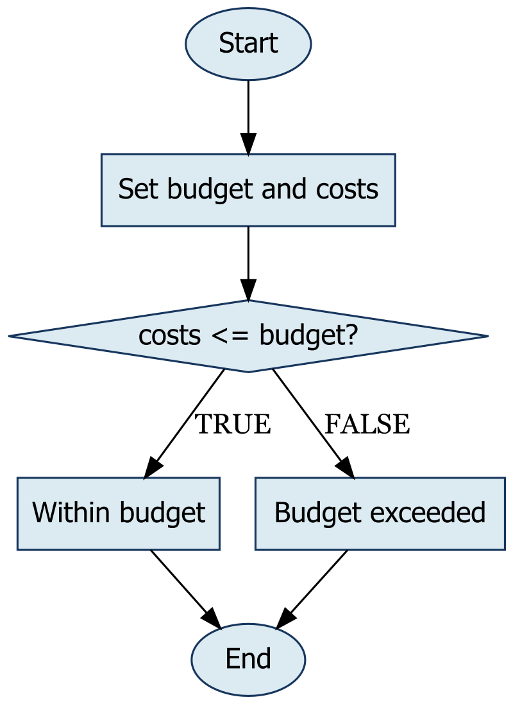

November 25, 2026

::: 


# Relevance

Making decisions is a big part of our daily life. Whether it is as
simple as asking oneself: "What am I going to cook today?" or more
important, like deciding what to study in the future.
Both of them are decisions that must be made and evaluated.
Deciding includes accepting preferred options and declining other
alternatives based on given criteria [@wang_cognitive_2007].
Furthermore, decisions are made based on the information available
in a particular context and aim to achieve a specific purpose
[@lunenburg_decision_2010, p. 2].

R control flow statements are an essential part of handling
complex data in decision-making. Conditional statements allow
programs to execute different instructions depending on whether
specific conditions are fulfilled [@chen_conditional_2025].

# Definition Control Flow Statements

Control flow refers to the order in which instructions are executed within a program. Unlike expressions, statements do not have a type or value but are executed to produce an effect [@stein_statements_nodate, p. 15].
Control flow statements influence the execution sequence by determining which instructions are followed next [@stein_statements_nodate, p. 2].
In the context of decision-making, conditional statements allow programs to respond to predefined conditions and execute appropriate actions. This supports the systematic implementation of rule-based decisions and provides flexibility when dealing with different scenarios [@chen_conditional_2025, p. 134].

## Types of Conditional Statements in R

Conditional statements enable a program to adapt its behavior according to different situations. Four common conditional structures in R are:

- **If Statement:** Allows a particular action to take place when a given requirement is accomplished.

- **If-Else Statement:** Provides two alternative paths, with the program following one depending on the outcome of a condition.

- **Else If Statement:** Introduces additional possibilities by checking several criteria in order until one is fulfilled [@chen_conditional_2025, p. 135].

- **Nested If Statement:** Incorporates one decision within another, making it possible to examine more specific circumstances [@zhang_automated_2018, p. 1].

In business systems, predefined rules determine how input information is processed to produce specific outcomes. @hatano_dependency-based_2016 [p. 1] explain that such rules can be implemented through conditional statements, which influence the results of computations. This demonstrates how conditional logic can be used to implement rule-based decisions in business applications.

# Flow Charts

## Definition and Outlines

Flowcharts are visual tools that illustrate processes and the relationships between individual steps through graphical elements, arrows, and short descriptions.
"Sometimes the simpler the method, the better" [@fulop_introduction_2005, p. 2].
Referring to this quotation, flowcharts can make complex information easier to understand by presenting processes in a clear and structured way. They can also support learning and comprehension by helping readers recognize connections between different stages of a process [@kimber_let_2018, p. 1].
Flowcharts are frequently used in decision-making processes. To understand flowcharts better, it is important to recognize that their visual elements have specific meanings. This includes the choice of shapes, colours, and sizes [@schultheiss_techniques_1963, p. 2]. The following visualization demonstrates the most important flowchart symbols and their meanings.

```{mermaid}
%%| fig-width: 6
%%| fig-height: 1.5
flowchart LR
    A(["Start / End"])
    B{"Decision"}
    C["Process"]
    D{{"Preparation"}}
    E["Flow Direction"]

    A ~~~ B
    B ~~~ C
    C ~~~ D
    D --> E

    style A fill:#DCEAF2,stroke:#17365D,color:#17365D
    style B fill:#DCEAF2,stroke:#17365D,color:#17365D
    style C fill:#DCEAF2,stroke:#17365D,color:#17365D
    style D fill:#DCEAF2,stroke:#17365D,color:#17365D
    style E fill:#DCEAF2,stroke:#17365D,color:#17365D
```

| Symbol | Meaning |
|:---|:---|
| **Terminator (Oval)** | Marks the beginning and end of a process. |
| **Decision (Diamond)** | Represents a decision with different possible outcomes. |
| **Process (Rectangle)** | Represents an action or processing step. |
| **Preparation (Hexagon)** | Indicates preparation or initialization. |
| **Flowline (Arrow)** | Shows the direction of the process. |

 Based on @chapin_flowcharting_1970 [p. 122].*

According to @kimber_let_2018 [p. 2], several guidelines can help make flowcharts clear and easy to understand.

### Guidelines for Flowcharts

| Sequence & Structure | Clarity & Connections |
|:---|:---|
| Steps should be arranged in a logical order, preferably from top to bottom or left to right. | Relationships are illustrated by showing how different steps or elements are connected. |
| A clear sequence illustrates processes that follow consecutive steps. | Clarity is provided by combining short descriptions with graphical elements. |
| Connecting arrows illustrate the direction of activities and can indicate repeated steps. | Connections between the elements should be easy to follow. |

*Source: Based on @kimber_let_2018 [p. 2].*

## Flow Chart Example in Project Management

Flowcharts are useful tools in project management because they help visualize complex processes, support communication, and facilitate decision-making.
An expert assessment of project management tools found that flowcharts received a mean usage-frequency rating of **3.25 out of 5**, indicating moderate use in project management [@patanakul_empirical_2010, p. 49].
The relevance of flowcharts in project management can be summarized through four main aspects:

| Aspect | Relevance in Project Management |
|:---|:---|
| **Planning & Execution** | Flowcharts support the visualization of processes during important project phases. |
| **Clarity** | They make complex processes and relationships easier to understand. |
| **Communication** | They promote shared understanding among stakeholders and help prevent misunderstandings. |
| **Risk Identification** | They help identify potential risks within project processes. |

Project management often involves processing large amounts of information, which can make communication and decision-making increasingly complex. Flowcharts help visualize these processes, promote shared understanding among stakeholders, and reduce misunderstandings [@radkevych_diagrams_2021, p. 1]. Furthermore, visualizing individual process steps can support the identification of potential risks [@aschwanden-granfelt_process_2017, p. 8].

### Rules for Flowcharts in Project Management

According to @jansen_flowchart_2017 [p. 6], three aspects are particularly important when visualizing projects:

1. **Overview:** The visualization should provide an overview of the project's current state on a single screen.

2. **Starting Point:** The project visualization should include a dedicated area illustrating the initial situation.

3. **Timeline & Objectives:** The initial situation and project objectives should be connected through a timeline, allowing individual work packages to be assigned to specific stages. 

Flowcharts are particularly relevant during the planning and execution phases of project management. They can illustrate project scope, schedules, and decision-making processes. For example, a project manager may need to determine whether project costs exceed the available budget. Such decisions can be represented through conditional branches in a flowchart [@burke_project_2013, p. 36; @patanakul_empirical_2010, pp. 51-52].

### Limitations of Flowcharts

Despite their advantages, flowcharts also have several limitations:

- **Time-consuming adjustments:** Changes to existing processes may require flowcharts to be revised or completely redrawn.

- **Increasing complexity:** Workflows involving numerous activities and decision paths can become difficult to read and understand.

- **Technical requirements:** Creating flowcharts may require suitable software and knowledge of standardized symbols.

These limitations can reduce the effectiveness of flowcharts, particularly when processes are complex or frequently changing [@aschwanden-granfelt_process_2017, pp. 9-12].
Nevertheless, flowcharts remain valuable tools for visualizing project processes and supporting structured decision-making.

# Control Statements and Flow Charts in R

Conditional statements and flowcharts can be combined to visualize decision-making processes in R. The following example demonstrates how an `if-else` statement can be used to evaluate whether project costs remain within a predefined budget.

## Practical Example: Budget Decision

Consider a project with an available budget of €50,000 and estimated costs of €55,000.
The following R code evaluates whether the project costs exceed the available budget.

```{r}
#| label: budget-decision
#| echo: true

budget <- 50000
costs <- 55000

if (costs <= budget) {
  print("Within budget")
} else {
  print("Budget exceeded")
}
```

The corresponding flowchart illustrates the decision-making process.

{#fig-budget-flowchart width=40%}


*Based on [@satorra_flowchart_2026; @soetaert_r_2014; @iannone_package_2016; @venables_introduction_2009; @wickham_syntax_2026; @geeksforgeeks_control_2025].*

*Based on [@satorra_flowchart_2026; @soetaert_r_2014; @iannone_package_2016; @venables_introduction_2009; @wickham_syntax_2026; @geeksforgeeks_control_2025].*

## Explanation of the R Code

Figure 1 illustrates how conditional statements can support budget-related decisions in R. First, the assignment operator `<-` assigns the values `50000` and `55000` to the variables `budget` and `costs`, respectively.
The `if` statement then evaluates the condition `costs <= budget`. The comparison operator `<=` checks whether the project costs are less than or equal to the available budget. The condition is enclosed in parentheses and must return a logical value (`TRUE` or `FALSE`) [@venables_introduction_2009, p. 40].
Curly brackets `{ }` define the blocks of code executed depending on the result.
If the condition is `TRUE`, the `print()` function displays `"Within budget"`.
Otherwise, the `else` statement executes the alternative block, displaying `"Budget exceeded"`. Since the costs (€55,000) exceed the budget (€50,000), the condition evaluates to `FALSE`, and the second message is shown.
The corresponding flowchart visualizes both possible decision paths, illustrating how conditional statements translate logical evaluations into specific outcomes [@wickham_syntax_2026; @geeksforgeeks_control_2025].

## Creating Flowcharts in R

Flowcharts can also be created programmatically in R using specialized packages.
@satorra_flowchart_2026 demonstrate this approach through the `flowchart` package, which provides functions for initializing, structuring, drawing, and exporting flowcharts.
The example presented in Figure 3 can alternatively be created using the `DiagrammeR` package. Its creation involves five main steps:

1. **Load the package:** `library(DiagrammeR)` provides the required visualization functions.

2. **Initialize the diagram:** `grViz()` and `digraph` define the flowchart structure.

3. **Define elements:** Shapes and labels represent processes, conditions, and outcomes.

4. **Connect elements:** Arrows establish the sequence and distinguish between `TRUE` and `FALSE` decision paths.

5. **Generate the visualization:** Executing the completed code produces the flowchart.

This example demonstrates how conditional decision-making can be represented visually, making the relationship between R control flow statements and flowcharts easier to understand [@iannone_package_2016].

\newpage

# References

::: {#refs}
:::

\newpage

# Affidavit

I hereby affirm that this submitted paper was authored unaided and solely by me. Additionally, no other sources than those in the reference list were used. Parts of this paper, including tables and figures, that have been taken either verbatim or analogously from other works have in each case been properly cited with regard to their origin and authorship. This paper either in parts or in its entirety, be it in the same or similar form, has not been submitted to any other examination board and has not been published.

I acknowledge that the university may use plagiarism detection software to check my thesis. I agree to cooperate with any investigation of suspected plagiarism and to provide any additional information or evidence requested by the university.

**Name:** Nina Schenk  
**Date:** 25 November 2026  
**Place:** Niederkassel