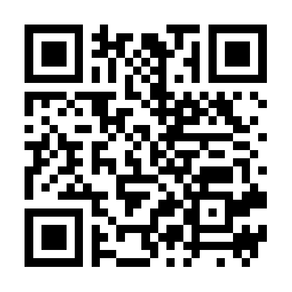

### Scan to Access the Handout

{width=180px}

## Contents

1.  R Control Statements
2.  Flowcharts and Symbols
3.  Flowcharts in Business
4.  Flowcharts in Project Management
5.  Limitations
6.  Kahoot Quiz

## R Control Statements

R uses control statements to determine which instructions are executed depending on a condition.

Four important control statements:

1.  `if`
2.  `if-else`
3.  `else if`
4.  Nested `if`

## 1. IF Statement

**Everyday example:**

"If it's raining, take an umbrella."

```{r}
raining <- TRUE

if (raining) {
  print("Take an umbrella")
}
```

**How it works:**

- R checks whether the condition is `TRUE`.
- If it is `TRUE`, the code inside `{ }` is executed.
- If it is `FALSE`, the code is skipped.

## 2. IF...ELSE Statement

**Everyday example:**

"If it's raining, take an umbrella. Otherwise, leave without one."

```{r}
raining <- FALSE

if (raining) {
  print("Take an umbrella")
} else {
  print("No umbrella needed")
}
```

**How it works:**

- `if` defines what happens when the condition is `TRUE`.
- `else` defines what happens when the condition is `FALSE`.

## 3. ELSE IF Statement

**Everyday example:**

"If it's raining, take an umbrella. If it's sunny, take sunglasses. Otherwise, just leave."

```{r}
weather <- "sunny"

if (weather == "rainy") {
  print("Take an umbrella")
} else if (weather == "sunny") {
  print("Take sunglasses")
} else {
  print("Just leave")
}
```

**How it works:**

- R checks the first condition.
- If it is `FALSE`, R checks the next condition using `else if`.
- If none of the conditions are `TRUE`, the `else` block is executed.

## 4. Nested IF Statement

**Everyday example:**

"If it's raining, check whether you have an umbrella. If you do, take it."

```{r}
raining <- TRUE
has_umbrella <- TRUE

if (raining) {
  if (has_umbrella) {
    print("Take your umbrella")
  }
}
```

**How it works:**

- A nested `if` statement is an `if` statement inside another `if` statement.

- The second condition is only checked if the first condition is `TRUE`.

- Both conditions must be `TRUE` for the message to appear.

  ::: {style="font-size: 10px; color: #888888; text-align: right; margin-top: 20px;"}
  Source: Zhang et al. (2018, p. 1)
  :::


## Business Example: Budget Decision {.smaller}

**Scenario:** A project manager needs to check whether project costs exceed the available budget.

- **Project budget:** €50,000
- **Project costs:** €55,000
- **Decision:** Are the costs within the budget?

```{r}
#| echo: true

budget <- 50000
costs <- 55000

if (costs <= budget) {
  print("Within budget")
} else {
  print("Budget exceeded")
}
```

::: {style="font-size: 11px; color: #888888; text-align: right;"}
Sources: Venables et al. (2009); Chen & Huang (2025).
:::

::: {style="font-size: 10px; color: rgb(136, 136, 136); text-align: right;"}
Sources: Venables et al. (2009); GeeksforGeeks (2025).
:::

## Visualizing the Budget Decision

```{r}
#| echo: false
#| warning: false
#| message: false

library(DiagrammeR)

grViz("
digraph {
  graph [layout = dot]

  Start [label = 'Start', shape = oval]
  Values [label = 'Set budget and costs', shape = box]
  Check [label = 'costs <= budget?', shape = diamond]
  Yes [label = 'Within budget', shape = box]
  No [label = 'Budget exceeded', shape = box]
  End [label = 'End', shape = oval]

  Start -> Values
  Values -> Check
  Check -> Yes [label = 'TRUE']
  Check -> No [label = 'FALSE']
  Yes -> End
  No -> End
}
")
```

## Connecting R Control Statements and Flowcharts

**How are control statements and flowcharts connected?**

::: {style="font-size: 24px;"}
- **R Control Statements:** Implement decisions by evaluating conditions and executing appropriate actions.

- **Flowcharts:** Visualize decision-making through sequences, decision points, and possible outcomes.

- **Connection:** Both support structured and understandable decision-making.
:::

::: {style="font-size: 11px; color: #888888; text-align: right; margin-top: 25px;"}
Sources: Chen & Huang (2025, p. 134); Kimber et al. (2018, p. 2).
:::


## Common Flowchart Symbols

| Symbol | Name        | Function                                                |
|:------------------------------:|--------------------|--------------------|
|   ⬭    | Oval | Marks the beginning or end of a process. |
|   ◇    | Diamond    | Represents a decision with different possible outcomes. |
|   ▭    | Rectangle     | Represents an action or processing step.                |
|   ⬡    | Hexagon | Represents a preparation or initialization step.        |
|   →    | Arrow | Indicates the direction and sequence of the process. |

::: {style="font-size: 10px; color: #888888; text-align: right; margin-top: 20px;"}
Source: Chapin (1970, p. 122)
:::

## Flowchart Example: Making Tea

**How can a simple everyday decision be visualized?**

```{r}
#| echo: false
#| warning: false
#| message: false

library(DiagrammeR)

grViz("
digraph {
  graph [layout = dot, rankdir = TB]

  node [fontname = Helvetica, fontsize = 14]

  Start [label = 'Start',
         shape = oval,
         style = filled,
         fillcolor = '#F8D7E8']

  Kettle [label = 'Turn on kettle',
          shape = box,
          style = filled,
          fillcolor = '#D6EAF8']

  Wait [label = 'Wait for kettle to boil',
        shape = box,
        style = filled,
        fillcolor = '#D6EAF8']

  Check [label = 'Water boiled?',
         shape = diamond,
         style = filled,
         fillcolor = '#FFF2B3']

  Pour [label = 'Pour water on teabag',
        shape = box,
        style = filled,
        fillcolor = '#D6EAF8']

  Brew [label = 'Wait 2–3 minutes',
        shape = box,
        style = filled,
        fillcolor = '#D6EAF8']

  Add [label = 'Add milk and sugar',
       shape = box,
       style = filled,
       fillcolor = '#D6EAF8']

  End [label = 'Stop',
       shape = oval,
       style = filled,
       fillcolor = '#F8D7E8']

  Start -> Kettle
  Kettle -> Wait
  Wait -> Check

  Check -> Pour [label = 'YES']
  Check -> Wait [label = 'NO']

  Pour -> Brew
  Brew -> Add
  Add -> End
}
")
```

::: {style="font-size: 10px; color: #888888; text-align: right;"}
Source: Adapted from Twinkl (n.d.).
:::

## Flowcharts in Business

**How can flowcharts support business decision-making?**

- **Follow a logical sequence:** Visualize processes step by step.
- **Avoid dead ends:** Ensure that each decision leads to a clear next step.
- **Identify risks:** Recognize potential problems and bottlenecks.
- **Make decisions clear:** Show different options and their consequences.
- **Keep it simple and precise:** Make processes understandable for everyone.

::: {style="font-size: 10px; color: #888888; text-align: right; margin-top: 20px;"}
Sources: Kimber et al. (2018, p. 2); Damij (2007).
:::

## Flowcharts in Project Management

**How can flowcharts support project management?**

- **Different levels of knowledge:** Help project stakeholders understand processes, even if they have different backgrounds.

- **Time scheduling:** Visualize the sequence of activities and important milestones.

- **Responsibilities:** Clarify who is responsible for individual tasks.

- **Work packages:** Illustrate how a project is divided into smaller, manageable activities.

::: {style="font-size: 10px; color: #888888; text-align: right; margin-top: 20px;"}
Sources: Radkevych (2021); Patanakul et al. (2010).
:::


::: {style="font-size: 10px; color: #888888; text-align: right;"}
Sources: Iannone & Roy (2016); Venables et al. (2009).

:::

## Limitations of Flowcharts

**What are the limitations of using flowcharts?**

- **Time-consuming updates:** Changes to existing processes may require flowcharts to be revised or redrawn.

- **Complexity:** Workflows with multiple decision paths can become difficult to read and understand.

- **Technical requirements:** Creating flowcharts requires suitable software and knowledge of standardized symbols.

::: {style="font-size: 10px; color: #888888; text-align: right; margin-top: 20px;"}
Source: Aschwanden-Granfelt (2017, pp. 9–12).
:::

## Practical Exercise: Kahoot Quiz

### Test Your Knowledge!

Join the quiz using the QR code or game PIN shown during the session.


## References (1/3)

::: {style="font-size: 13px; line-height: 1.5;"}
Aschwanden-Granfelt, S. (2017). *Process flow documentation: A flowchart guide for micro & small business.*

Burke, R. (2013). *Project management: Planning and control techniques.* John Wiley & Sons.

Chapin, N. (1970). Flowcharting with the ANSI standard: A tutorial. *ACM Computing Surveys, 2*(2), 119–146.

Chen, Y., & Huang, L. (2025). Conditional statements. *MATLAB Roadmap to Applications*, 133.

Damij, N. (2007). Business process modelling using diagrammatic and tabular techniques. *Business Process Management Journal, 13*(1), 70–90.

Fülöp, J. (2005). Introduction to decision making methods. *BDEI-3 Workshop, Washington*, 1–15.

GeeksforGeeks. (2025). *Control statements in R programming.*

Haibt, L. M. (1959). A program to draw multilevel flow charts. *Western Joint Computer Conference*, 131–137.
:::
